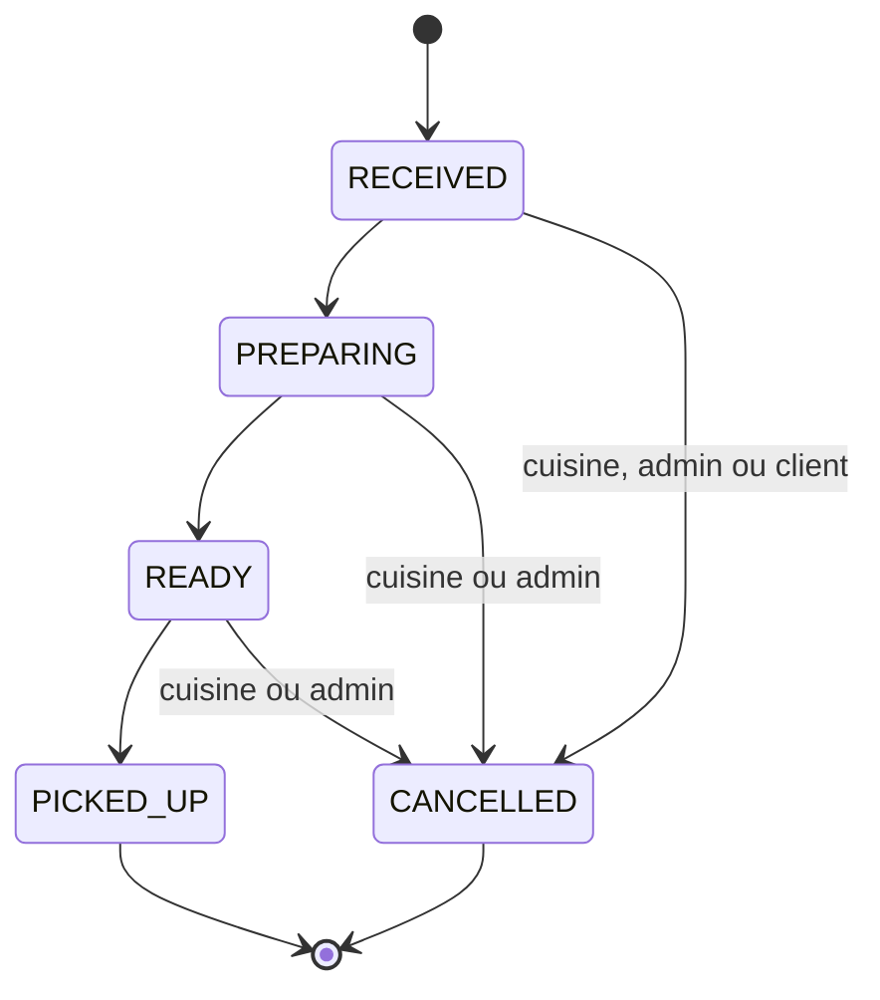
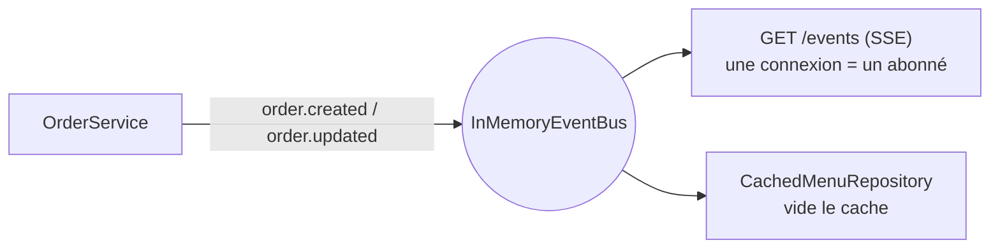
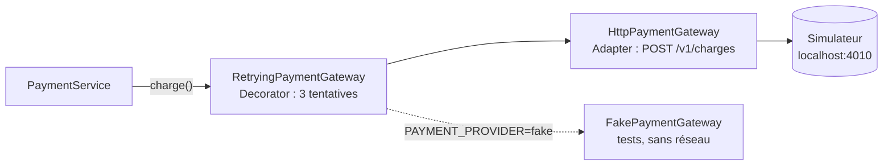
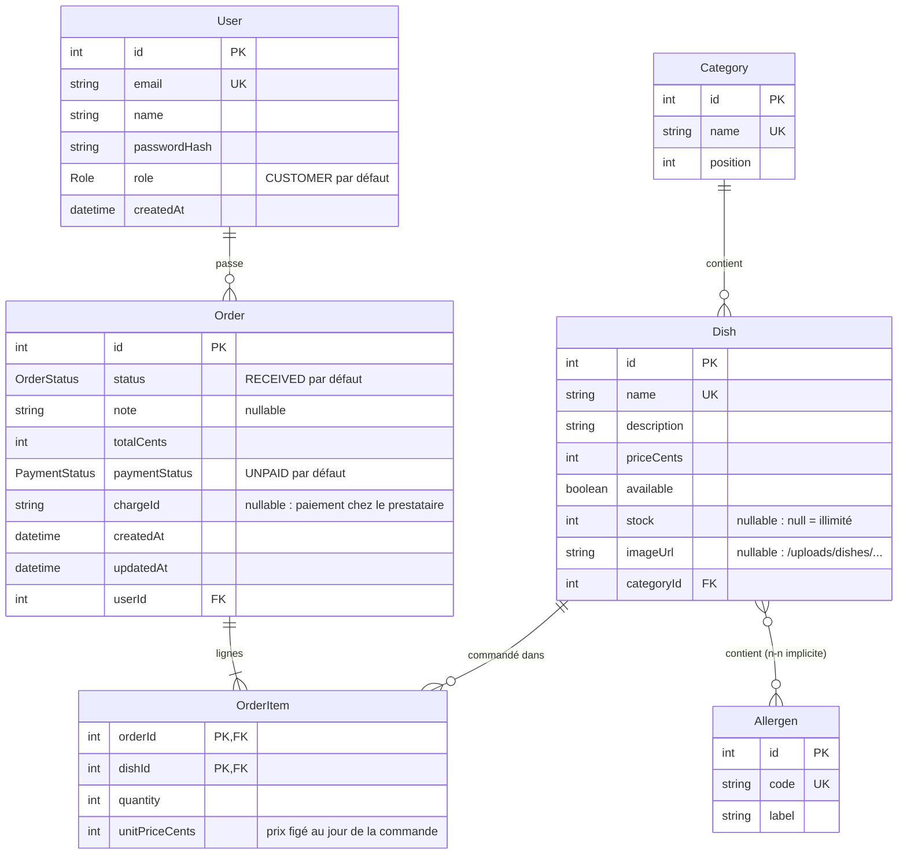

# La Roulotte — API

API de click & collect du food truck La Roulotte : carte, comptes, commandes, suivi en temps réel, paiement en ligne.
Stack : Node.js 22+, TypeScript strict, Express 5, Prisma 7 (SQLite), Zod, Vitest, Supertest ; multer, file-type et pino au palier 3 ; swagger-ui-express et GitHub Actions au palier 4.

## Palier atteint : 4 ✅ + 2 options

| Palier | Recette | Tag |
|---|---|---|
| 1 — Service minimum | `npm run recette:1` : **37 / 37** | `palier-1` |
| 2 — Administration, stock, cycle de vie | `npm run recette:2` : **52 / 52** (paliers 1 et 2) | `palier-2` |
| 3 — Exploitation, temps réel, photos, cache | `npm run recette:3` : **64 / 64** (paliers 1 à 3) | `palier-3` |
| 4 — Encaissement + 2 options | `npm run recette:4` : **71 / 71** (paliers 1 à 4, simulateur lancé) | `palier-4` |

- Options choisies : **documentation interactive** (Swagger UI sur `/docs`) et **intégration continue** (GitHub Actions). Voir [Options du palier 4](#options-du-palier-4).
- Nos tests (`npm test`) : **82 tests verts**, dont des tests unitaires de services, de la machine à états, du cache (Decorator), de l'upload, et de l'adaptateur de paiement face à un faux prestataire.
- Parcours dans le front : connexion, carte avec photos, panier, commande, paiement, suivi en direct et annulation dans « Mes commandes », écran cuisine mis à jour sans recharger, administration de la carte et des photos.

## Lancement en 5 commandes

Prérequis : **Node.js 22 ou plus** (`node -v`), et le kit du projet (`la-roulotte-kit`) dans un dossier à part.

```powershell
npm ci                          # dépendances exactes + génération du client Prisma (postinstall)
Copy-Item .env.example .env     # (bash : cp .env.example .env) puis remplacer JWT_SECRET
npx prisma migrate deploy       # crée dev.db et applique les migrations
npm run seed                    # charge la carte et les 3 comptes de démonstration
npm run dev                     # http://localhost:3000
```

Vérification : `curl.exe http://localhost:3000/health` répond `{"status":"ok","database":"up"}`, et la documentation interactive s'ouvre sur http://localhost:3000/docs.

### Le fichier `.env`

Le `.env` n'est jamais commité : chacun a le sien, créé à partir de `.env.example`.
`JWT_SECRET` doit faire 16 caractères au moins, sinon l'API refuse de démarrer. Pour en générer un :

```powershell
node -e "console.log(require('crypto').randomBytes(32).toString('hex'))"
```

| Variable | Rôle | Valeur par défaut |
|---|---|---|
| `PORT` | Port HTTP de l'API | `3000` |
| `DATABASE_URL` | Fichier SQLite | `file:./dev.db` |
| `JWT_SECRET` | Secret de signature des jetons | à générer |
| `JWT_EXPIRES_IN` | Durée de validité des jetons | `2h` |
| `CORS_ORIGIN` | Origine autorisée (le front) | `http://localhost:5173` |
| `LOG_LEVEL` | Niveau des logs pino (`fatal` … `trace`, `silent`) | `info` |
| `UPLOADS_DIR` | Dossier des photos des plats, servi sous `/uploads` | `uploads` |
| `PAYMENT_URL` | Adresse du prestataire de paiement (le simulateur du kit) | `http://localhost:4010` |
| `PAYMENT_API_KEY` | Clé secrète du prestataire (`sk_test_roulotte` pour le simulateur) | **obligatoire**, aucune valeur dans le code |
| `PAYMENT_PROVIDER` | Implémentation choisie par la Factory : `http` (prestataire réel) ou `fake` (sans réseau) | `http` |
| `PAYMENT_TIMEOUT_MS` | Délai maximum d'**une** tentative | `2000` |
| `PAYMENT_MAX_ATTEMPTS` | Nombre de tentatives au plus | `3` |
| `PAYMENT_RETRY_BASE_MS` | Attente avant la 2e tentative, doublée ensuite | `200` |

La configuration est validée au démarrage par Zod ([src/config.ts](src/config.ts)) : une variable absente ou invalide arrête l'API avec un message explicite.

## Scripts

| Commande | Effet |
|---|---|
| `npm run dev` | Lance l'API et la relance à chaque modification |
| `npm start` | Lance l'API sans rechargement |
| `npm run seed` | Vide la base et recharge `donnees/menu.json` |
| `npm test` | Lance nos tests (Vitest + Supertest), sans base ni API lancée |
| `npm run typecheck` | Vérifie les types TypeScript |

## Travailler avec le kit

Dans un **second terminal**, depuis le dossier `la-roulotte-kit` (l'API doit tourner) :

```powershell
npm run front          # le front sur http://localhost:5173
npm run recette:1      # recette du palier 1 (recette:2, :3, :4 pour les suivants)
```

Pour le paiement (palier 4), le **simulateur** doit tourner dans un troisième terminal, toujours depuis le kit :

```powershell
npm run paiement       # simulateur de paiement sur http://localhost:4010
npm run recette:4      # dans un autre terminal
```

La recette crée des comptes, des plats et des commandes : relancer `npm run seed` pour repartir d'une base propre.

| Email | Mot de passe | Rôle |
|---|---|---|
| admin@roulotte.test | Admin123! | ADMIN |
| cuisine@roulotte.test | Cuisine123! | STAFF |
| client@roulotte.test | Client123! | CUSTOMER |

## Routes

| Requête | Accès | Effet | Palier |
|---|---|---|---|
| `GET /health` | public | Interroge la base : `{ "status": "ok", "database": "up" }`, ou **503** `{ "status": "degraded", "database": "down" }` | 1, 3 |
| `GET /categories` | public | Catégories triées par position | 1 |
| `GET /allergens` | public | Les 14 allergènes, triés par code | 1 |
| `GET /dishes` | public | Carte paginée ; filtres `category`, `available`, `allergenFree`, `q` ; chaque plat expose son `stock` (`null` = illimité) | 1, 2 |
| `GET /dishes/:id` | public | Un plat | 1 |
| `POST /dishes` | ADMIN | Créer un plat (201 + `Location`) ; 409 si le nom existe, 422 si catégorie ou allergène inconnu | 2 |
| `PATCH /dishes/:id` | ADMIN | Modification partielle et stricte | 2 |
| `DELETE /dishes/:id` | ADMIN | 204 ; **409** si le plat a déjà été commandé | 2 |
| `PUT /dishes/:id/image` | ADMIN | Photo du plat (multipart, champ `image`) ; renvoie le plat avec son `imageUrl` ; 400 sans fichier, **413** au-delà de 2 Mo, **415** si ce n'est pas une image PNG, JPEG ou WebP | 3 |
| `GET /uploads/dishes/<fichier>` | public | Les photos, servies en statique, affichables depuis le front (`Cross-Origin-Resource-Policy: cross-origin`) | 3 |
| `POST /auth/register`, `POST /auth/login`, `GET /auth/me` | module fourni | Inscription (toujours CUSTOMER), connexion, compte connecté | 1 |
| `POST /orders` | connecté | Passer une commande (201 + `Location`), créée `paymentStatus: "UNPAID"` ; décrémente le stock, **409 `OUT_OF_STOCK`** si insuffisant | 1, 2, 4 |
| `GET /orders` | connecté | Ses commandes ; toutes pour STAFF et ADMIN ; filtres `status`, `sort` | 1 |
| `GET /orders/:id` | connecté | Sa commande ; toutes pour STAFF et ADMIN ; **404** pour celle d'un autre client | 1 |
| `PATCH /orders/:id/status` | connecté | La cuisine fait avancer la commande ; le client peut seulement annuler la sienne tant qu'elle est `RECEIVED` | 2 |
| `POST /orders/:id/payment` | client de la commande | Payer (`{ "token": "tok_visa" }`) : 200 et `paymentStatus: "PAID"` ; **402** refusé, **409** déjà payée ou annulée, **502** / **504** prestataire en panne ou trop lent ; 403 pour la cuisine et l'admin, 404 pour un autre client | 4 |
| `GET /events` | connecté | Flux SSE (`text/event-stream`) : `order.created` pour la cuisine et l'admin, `order.updated` pour eux et pour le client propriétaire | 3 |
| `GET /docs` | public | Documentation interactive (Swagger UI) du contrat ; le contrat brut sur `/docs/openapi.json` | option 4 |

Sur les routes d'administration et de paiement, l'authentification (401) et le rôle (403) sont vérifiés **avant** la validation du corps, et avant la lecture du fichier pour la photo.

Chaque réponse, succès ou erreur, porte un en-tête **`X-Request-Id`**, que l'on retrouve dans les logs de la requête.

## Stock et cycle de vie des commandes (palier 2)

### Machine à états



Les transitions sont décrites une seule fois, sous forme de table (`ALLOWED_TRANSITIONS` dans [order.state-machine.ts](src/modules/orders/order.state-machine.ts)), et non par des `if` dispersés. Les vérifications se font dans cet ordre :

| Cas | Réponse |
|---|---|
| Commande inexistante, ou d'un autre client | **404** (on ne révèle pas qu'elle existe) |
| Client qui demande autre chose que `CANCELLED` | **403** `FORBIDDEN` |
| Transition absente de la table (étape sautée, même statut, après `PICKED_UP`, client qui annule après `RECEIVED`) | **409** `INVALID_TRANSITION` |
| Statut hors contrat (`"EN_COURS"`…) | **400** `VALIDATION_ERROR` |

Le changement de statut est **conditionnel** (`where: { id, status: from }`) : si deux requêtes modifient la même commande en même temps, une seule passe, l'autre reçoit 409. Une annulation **remet les portions en stock**, dans la même transaction.

### Stock

- `stock` vaut `null` pour un plat illimité, sinon le nombre de portions restantes.
- Le décrément est **conditionnel et atomique** : `updateMany` avec `stock >= quantité` dans le filtre. La base vérifie et décrémente en une seule opération, ce qui évite qu'une lecture puis une écriture vendent deux fois la dernière portion. La recette le vérifie avec 6 commandes simultanées pour 3 portions : 3 sont acceptées, 3 refusées, et le stock final vaut 0.
- **Tout ou rien** : toutes les lignes sont traitées dans une même `$transaction`. Si une seule manque de stock, l'erreur levée dans la transaction annule tout, et la réponse 409 liste chaque plat concerné avec `{ dishId, available }`.
- Le repository renvoie `{ ok: false, insufficient }` sans rien savoir de HTTP ; c'est le service qui le traduit en 409 `OUT_OF_STOCK`.

## Temps réel, photos et cache (palier 3)

### Un bus d'événements, deux abonnés



Le service publie **après** l'écriture réussie et **avant** la réponse HTTP : quand le client reçoit son 201, le cache est déjà vidé et la cuisine a déjà reçu la commande. Rien n'est publié si la commande est refusée (stock, plat indisponible) ou si la transition est invalide. Le bus est créé une seule fois, dans la composition root : un abonné en erreur ne casse ni la commande ni les autres abonnés.

### Flux SSE `GET /events`

- Authentifié par l'en-tête `Authorization` (401 sans jeton) : le front lit le flux avec `fetch`, pas `EventSource`.
- Chaque message suit le format SSE : `event: order.created`, puis `data:` avec la commande au **format `Order` du contrat**, en JSON sur une ligne, puis une ligne vide.
- **Qui reçoit quoi** ([event-filter.ts](src/modules/events/event-filter.ts)) : la cuisine et l'admin reçoivent tout ; un client ne reçoit que `order.updated` de **ses** commandes, jamais celles des autres ni `order.created`.
- Un commentaire `: ping` toutes les 25 s empêche les proxys et le navigateur de couper une connexion silencieuse.
- À la fermeture (`res.on("close")`), le minuteur est arrêté et l'abonné retiré du bus : pas de fuite mémoire quand un onglet se ferme.

### Photos des plats `PUT /dishes/:id/image`

1. **multer en mémoire**, limité à 2 Mo et à un seul fichier : rien n'est écrit sur le disque avant vérification (au-delà → 413).
2. Le type est lu dans les **premiers octets** du fichier avec `file-type`, jamais dans l'extension ou le type déclaré, qui se falsifient : seuls PNG, JPEG et WebP sont acceptés (sinon 415).
3. Le **nom est généré par le serveur** (`<uuid>.png`) : le nom envoyé par le client n'est jamais utilisé.
4. Si la base échoue, le nouveau fichier est supprimé ; si elle réussit, l'**ancienne photo est supprimée** et son URL répond 404.

Le service ([dish-image.service.ts](src/modules/menu/image/dish-image.service.ts)) ne connaît pas le disque : il passe par l'interface `ImageStorage`, implémentée par `LocalImageStorage`.

### Cache de la carte (Decorator)

[CachedMenuRepository](src/modules/menu/cached-menu.repository.ts) implémente la **même interface** `MenuRepository` que la version Prisma et l'enveloppe ; il est branché dans la composition root, ni le service ni Prisma ne le savent.

| Méthode | Comportement |
|---|---|
| `listCategories`, `listAllergens`, `listDishes`, `findDishById` | En cache (60 s), une entrée par combinaison de filtres et de page |
| `findDishesByIds`, `findDishByName`, `categoryExists`, … | **Jamais en cache** : le prix et le stock lus pour commander doivent être exacts |
| `createDish`, `updateDish`, `deleteDish`, `setDishImage` | Écrivent, puis vident le cache : la modification est visible immédiatement |
| Événement `order.created` / `order.updated` | Vide le cache : le stock affiché suit les commandes et les annulations |

Un compteur de génération évite qu'une lecture commencée **avant** une écriture remette en cache une donnée périmée.

### Logs et santé

- **pino** + **pino-http** : un log JSON par requête, avec son `X-Request-Id` (UUID généré par l'API). Le jeton et les cookies sont masqués (`redact`).
- Une erreur imprévue est loguée avec sa pile, et la réponse reste un 500 générique au format du contrat.
- `/health` exécute `SELECT 1` : si la base ne répond pas, 503 `degraded`.

## Paiement (palier 4)

### Trois couches entre le service et le prestataire



- **Le port** ([payment-gateway.ts](src/modules/payments/payment-gateway.ts)) : l'interface `PaymentGateway`, dans les mots du métier. Un refus est une **réponse** (`declined`) ; une panne passagère est une **erreur** (`PaymentProviderError`, `timeout` ou `error`).
- **L'Adapter** ([http-payment-gateway.ts](src/modules/payments/http-payment-gateway.ts)) : traduit vers l'API du prestataire (clé secrète, `Idempotency-Key`, `currency: "EUR"`, référence `order-<id>`), coupe chaque appel avec `AbortSignal.timeout(2000)` et **valide la réponse avec Zod** : on ne fait pas confiance à une API externe.
- **Le Decorator** ([retrying-payment-gateway.ts](src/modules/payments/retrying-payment-gateway.ts)) : rejoue la **même** requête, donc la même `Idempotency-Key`, au plus 3 fois, avec une attente croissante (200 ms, puis 400 ms).
- **La Factory** ([payment-gateway.factory.ts](src/modules/payments/payment-gateway.factory.ts)) : `PAYMENT_PROVIDER` choisit l'implémentation (HTTP pour l'application, factice pour les tests) ; le reste de l'application ne voit que `PaymentGateway`.

### Quelle réponse pour quel cas

| Réponse du prestataire | Nouvelle tentative ? | Réponse de l'API |
|---|---|---|
| 201 `succeeded` (`tok_visa`) | — | **200**, `paymentStatus: "PAID"` |
| 402 `declined` (`tok_declined`) | **jamais** : la carte est refusée, réessayer ne change rien | **402** `PAYMENT_DECLINED`, commande toujours `UNPAID` |
| 503 puis 201 (`tok_flaky`) | oui, avec la même clé : le prestataire rejoue sa réponse **sans débiter une seconde fois** | **200** |
| 5xx ou réseau coupé, 3 fois (`tok_down`) | oui, 3 tentatives | **502** `PAYMENT_PROVIDER_ERROR` |
| Pas de réponse en 2 s, 3 fois (`tok_slow`) | oui, 3 tentatives | **504** `PAYMENT_PROVIDER_TIMEOUT` (≈ 6,6 s au total) |
| 400 ou 401 (notre requête ou notre clé est fausse) | non : c'est notre configuration | **500**, l'erreur est loguée |

### Règles du service

[payment.service.ts](src/modules/payments/payment.service.ts) vérifie tout ce qui peut l'être **avant** d'appeler le prestataire, qui n'est donc jamais sollicité pour une demande refusée d'avance :

1. Cuisine ou admin → **403** (déjà refusé par `requireRole("CUSTOMER")` sur la route, avant même la lecture du corps).
2. Commande inexistante ou d'un autre client → **404**.
3. Commande déjà payée ou annulée → **409** `CONFLICT`.

Le montant vient de la base (`totalCents`), jamais du client : le corps n'accepte que `{ token }` (`strictObject`). Chaque paiement reçoit une **nouvelle** `Idempotency-Key` (UUID) : après un refus, payer avec une autre carte est un nouveau paiement. Le passage à `PAID` est **conditionnel** (`markPaid` ne modifie qu'une commande encore `UNPAID` et non annulée) et publie `order.updated` : la cuisine voit le paiement en direct.

## Options du palier 4

### Documentation interactive : Swagger UI sur `/docs`

- Le contrat fourni est copié **tel quel** dans [docs/openapi.yaml](docs/openapi.yaml) (le kit, lui, n'est pas modifié) et servi par `swagger-ui-express` ([docs.routes.ts](src/modules/docs/docs.routes.ts)) ; `/docs/openapi.json` donne le contrat brut.
- Pour essayer une route protégée : `POST /auth/login` (**Try it out**), copier le `token`, cliquer sur **Authorize** et le coller sans `Bearer `.
- Attention : les requêtes partent vers `http://localhost:3000` (le `servers` du contrat) et modifient la vraie base `dev.db`.
- Swagger UI ne charge que des scripts externes : la politique de sécurité de Helmet (`script-src 'self'`) n'a pas eu besoin d'être assouplie.

### Intégration continue : GitHub Actions

[.github/workflows/ci.yml](.github/workflows/ci.yml) s'exécute à chaque `push` et à chaque pull request, sous **Node 22 et 24** : `npm ci` (qui génère aussi le client Prisma), `npm run typecheck`, `npm test`. Les tests n'ont besoin ni de base ni de prestataire (`PAYMENT_PROVIDER=fake` dans la configuration de test) : la CI n'a aucun service à lancer. Le résultat s'affiche dans l'onglet **Actions** du dépôt et sur chaque commit.

## Ce qui ne marche pas (encore)

- **Recherche `q`** : insensible à la casse pour les lettres sans accent seulement (limite de `LIKE` sous SQLite) ; « é » et « É » ne sont pas confondus.
- **Tri des plats par nom** : SQLite compare octet par octet. Les plats du seed sont bien triés, mais un plat créé avec une minuscule ou un accent en tête de nom pourrait être mal placé.
- **Un seul processus** : le bus d'événements et le cache sont en mémoire. Avec plusieurs instances de l'API, il faudrait un bus partagé (Redis, par exemple).
- **SSE sans rattrapage** : un événement émis pendant une coupure de connexion est perdu (pas d'identifiant d'événement ni de `Last-Event-ID`) : après une reconnexion, il faut relire `GET /orders`.
- **Photos sur le disque local** : elles ne survivent pas à un hébergement sans disque persistant.
- **Annulation pendant un paiement** : si la commande est annulée pendant l'appel au prestataire, le client est débité mais l'API répond 409. Un vrai système devrait rembourser (ou bloquer l'annulation pendant le paiement).
- **Paiement en doute après un 502 / 504** : le prestataire a pu enregistrer le paiement sans que nous recevions sa réponse. La clé d'idempotence n'est pas conservée en base : si le client recommence, c'est un nouveau paiement. Il faudrait garder la clé avec la commande et interroger le prestataire.

## Schéma de données



Les trois formes de relation demandées sont présentes :
- **1-n** : `User` → `Order`, `Category` → `Dish` ;
- **n-n implicite** : `Dish` ↔ `Allergen` (table de jointure gérée par Prisma) ;
- **n-n explicite** : `Order` ↔ `Dish` via `OrderItem`, avec une clé composite `(orderId, dishId)` et des données propres (quantité, prix figé).

`OrderItem → Dish` est en `onDelete: Restrict` : un plat déjà commandé ne peut pas être supprimé. `OrderItem → Order` est en `onDelete: Cascade`.

## Architecture

```
src/
├── server.ts            point d'entrée : crée les repositories Prisma, le container, lance l'app
├── app.ts               createApp(container) : middlewares et routes, dans l'ordre imposé
├── container.ts         composition root : assemble repositories → services → controllers
├── config.ts            configuration .env validée par Zod
├── db/prisma.ts         le PrismaClient unique
├── shared/              écrit une seule fois : erreurs, gestionnaire d'erreurs, validation, pagination, bus d'événements
├── fourni/auth/         module d'authentification fourni (non modifié)
└── modules/
    ├── users/           UserRepository (branché sur le module d'auth)
    ├── health/          GET /health (vérifie la base)
    ├── menu/            carte : catégories, allergènes, plats, cache (Decorator), upload
    │   └── image/       photos : vérification du type, stockage, DishImageService
    ├── orders/          commandes
    ├── events/          flux SSE /events et règle « qui reçoit quoi »
    ├── payments/        paiement : port, Adapter HTTP, nouvelles tentatives, Factory, service, route
    └── docs/            Swagger UI sur /docs (option)
docs/openapi.yaml        copie du contrat fourni, servie par /docs
.github/workflows/       intégration continue (option)
uploads/                 photos des plats (créé à la volée, jamais commité)
tests/
├── fakes/               repositories en mémoire (même interface que Prisma)
├── helpers/test-app.ts  construit l'app sans base, crée des comptes de test
└── *.test.ts            tests unitaires (services) et HTTP (Supertest)
```

Chaque module suit le même découpage :

| Couche | Fichier | Rôle |
|---|---|---|
| Routes | `*.routes.ts` | Chemins et protections (`requireAuth`, `requireRole`) |
| Controller | `*.controller.ts` | Valide l'entrée (Zod), appelle le service, renvoie le DTO. Seule couche qui voit `req`/`res` |
| Service | `*.service.ts` | Règles métier (prix, refus, propriété des commandes). Ni HTTP ni Prisma |
| Repository | `*.repository.ts` | Interface et types du domaine |
| Implémentation | `prisma-*.repository.ts` | Seul endroit qui importe Prisma |
| Entrée / sortie | `*.schemas.ts`, `*.dto.ts` | Schémas Zod stricts ; fonctions `toXxxDto` |

Ordre des middlewares ([src/app.ts](src/app.ts)) : `pino-http` (logs et `X-Request-Id`, en tout premier pour que même une erreur porte l'identifiant) → `installSecurity` (Helmet, CORS, JSON limité à 100 ko) → `/health` et `/uploads` → routes → 404 → `authErrorHandler` → notre gestionnaire d'erreurs unique (qui traduit aussi les erreurs de multer en 400 / 413).

### Choix et patterns, justifiés par le projet

| Pattern / principe | Problème du projet | Où |
|---|---|---|
| **Composition root** + **inversion des dépendances** | Les services ne doivent connaître ni Prisma ni la base, pour être testés sans elle | [src/container.ts](src/container.ts) |
| **Factory** | Construire la même application avec des repositories Prisma (en production) ou en mémoire (dans les tests) | `createApp` ([src/app.ts](src/app.ts)), `createContainer` ([src/container.ts](src/container.ts)) |
| **Singleton** | Un seul pool de connexions à la base pour toute l'application | [src/db/prisma.ts](src/db/prisma.ts) |
| **DAO / Repository** | Isoler tout accès aux données derrière une interface par agrégat | `menu.repository.ts`, `order.repository.ts`, `user.repository.ts` et leurs versions `prisma-*` |
| **Adapter** | Le module d'auth fourni attend un `AuthUserStore` : notre `UserRepository` respecte cette interface | [src/modules/users/user.repository.ts](src/modules/users/user.repository.ts) |
| **DTO** | Ne jamais exposer `passwordHash` ni de champ hors contrat ; refuser `role`, `unitPriceCents`… en entrée | `*.schemas.ts` (`strictObject`), `*.dto.ts` |
| **ISP** | Le service des commandes n'a besoin que de lire les prix des plats | `Pick<MenuRepository, "findDishesByIds">` dans [order.service.ts](src/modules/orders/order.service.ts) |
| **DRY** | Format d'erreur, validation, pagination et sélections Prisma écrits une seule fois | [src/shared/](src/shared/), `dishSelect`, `orderInclude` |
| **Machine à états (table de transitions)** | Les règles de changement de statut doivent être lisibles et modifiables en un seul endroit | [order.state-machine.ts](src/modules/orders/order.state-machine.ts) |
| **Verrou optimiste** | Deux requêtes simultanées ne doivent ni survendre le stock ni annuler deux fois une commande | `updateMany` conditionnels dans [prisma-order.repository.ts](src/modules/orders/prisma-order.repository.ts) |
| **Observer** | Une commande doit prévenir la cuisine (SSE) et vider le cache, sans que le service connaisse ni l'un ni l'autre | [event-bus.ts](src/shared/event-bus.ts) ; abonnés : [event-controller.ts](src/modules/events/event-controller.ts), [cached-menu.repository.ts](src/modules/menu/cached-menu.repository.ts) |
| **Decorator** | Mettre la carte en cache sans toucher ni au service ni au repository Prisma | [cached-menu.repository.ts](src/modules/menu/cached-menu.repository.ts), branché dans [src/container.ts](src/container.ts) |
| **Adapter (paiement)** | Le métier parle de « payer une commande » ; le prestataire attend son propre format HTTP, sa clé et ses codes | `PaymentGateway` ([payment-gateway.ts](src/modules/payments/payment-gateway.ts)), `HttpPaymentGateway` ([http-payment-gateway.ts](src/modules/payments/http-payment-gateway.ts)) |
| **Factory (paiement)** | HTTP pour l'application, factice pour les tests, choisi par la configuration et non par le code | [payment-gateway.factory.ts](src/modules/payments/payment-gateway.factory.ts) |
| **Decorator (nouvelles tentatives)** | Un prestataire peu fiable : réessayer sans toucher à l'Adapter, et sans débiter deux fois (même `Idempotency-Key`) | [retrying-payment-gateway.ts](src/modules/payments/retrying-payment-gateway.ts) |
| **Inversion des dépendances (stockage)** | Le service des photos ne doit pas dépendre du disque, pour être testé sans lui et changer de stockage plus tard | interface `ImageStorage`, `LocalImageStorage` dans [image-storage.ts](src/modules/menu/image/image-storage.ts) |

### Contrôle d'accès

- La carte est publique en lecture ; sa modification (`POST`, `PATCH`, `DELETE /dishes`) est réservée à l'ADMIN. Le routeur `/orders` est entièrement protégé par `requireAuth`.
- `PATCH /orders/:id/status` n'a pas de `requireRole` : le client y a droit pour annuler. Qui peut faire quelle transition est décidé par la machine à états.
- La **propriété** d'une commande est vérifiée dans le service : un client ne voit que les siennes. La commande d'un autre client répond **404 et non 403**, pour ne pas révéler qu'elle existe.
- Les **prix viennent toujours de la base** : le client n'envoie que `dishId` et `quantity` ; `unitPriceCents` fige le prix du jour.
- L'inscription donne toujours le rôle CUSTOMER : un champ `role` envoyé est refusé (400).

## Tests

```powershell
npm test
```

Ils tournent **sans base ni API lancée** : `buildTestApp()` construit l'application avec des repositories en mémoire ([tests/fakes/](tests/fakes/)), qui respectent les mêmes interfaces que les versions Prisma.

| Fichier | Type | Ce qui est vérifié |
|---|---|---|
| `app.test.ts` | HTTP | `/health` (base joignable ou non → 503), `X-Request-Id` différent à chaque réponse, 404 au format du contrat, inscription → connexion → `/auth/me`, 401, rôle refusé |
| `menu.service.test.ts` | unitaire | 404 sur plat inexistant, format de page |
| `menu.http.test.ts` | HTTP | tri, pagination, filtres, 400 et 404 |
| `order-place.test.ts` | unitaire + HTTP | prix lus en base, refus cumulés (422) sans écriture, 401, 201 + `Location`, 400 |
| `order-access.test.ts` | HTTP | un client ne voit que ses commandes, 404 pour celle d'un autre, la cuisine voit tout |
| `menu-admin.test.ts` | HTTP | création, modification, suppression ; 401 / 403 avant validation ; 409 ; 422 ; valeurs par défaut |
| `order-state-machine.test.ts` | unitaire | cycle complet, états finaux, 409 sur étape sautée, droits du client (403 / 409) |
| `order-status.test.ts` | unitaire + HTTP | transition écrite avec son statut de départ, 409 si le statut a changé entre-temps, parcours cuisine, 403 / 404 / 400 |
| `order-stock.test.ts` | unitaire | stock insuffisant → 409 `OUT_OF_STOCK` avec les portions restantes |
| `menu-cache.test.ts` | unitaire | Decorator : deuxième lecture servie par le cache, une clé par filtre, écriture visible immédiatement, vidé par un événement de commande, `findDishesByIds` jamais en cache |
| `menu-image.test.ts` | unitaire + HTTP | nouvelle photo enregistrée et ancienne supprimée, faux PNG → 415 sans écriture ; 200 + `imageUrl`, image servie avec CORP, remplacement (ancienne URL → 404), 413, 400, 403, 404 |
| `payment-gateway.test.ts` | unitaire + HTTP | Adapter face à un faux prestataire HTTP local (en-têtes, corps, 201, 402, 5xx, connexion coupée, réponse mal formée, délai dépassé, mauvaise clé) ; nouvelles tentatives (même clé, 3 au plus, jamais sur un refus) ; Factory |
| `payment.test.ts` | unitaire + HTTP | service avec le faux prestataire (PAID, 402, 502, 504, nouvelle clé par paiement, aucun appel si 403 / 404 / 409) ; `POST /orders/:id/payment` (UNPAID → PAID, 409, `tok_flaky`, 401, 403 avant validation, 400) |
| `docs.test.ts` | HTTP | `/docs` sert Swagger UI, `/docs/openapi.json` le contrat |
| `events.test.ts` | unitaire + HTTP | qui reçoit quoi selon le rôle et le propriétaire, publication de `order.created` / `order.updated` (et rien si la commande est refusée), 401, vrai flux SSE où la cuisine reçoit la commande |

La recette du kit complète ces tests en vérifiant le contrat sur l'API réelle, avec la vraie base. Le stock et la concurrence ne sont vérifiés que là : les faux repositories n'ont ni transactions ni accès concurrents. De même, le vrai simulateur de paiement n'est appelé que par la recette 4 ; nos tests utilisent un faux prestataire (`FakePaymentGateway`) ou un petit serveur HTTP local.

## Répartition du travail

| Membre | Contributions |
|---|---|
| **Matthieu** | Initialisation du projet (Express, Prisma 7, configuration), socle commun (erreurs, validation, pagination, composition root), branchement du module d'auth, module `menu`, `POST /orders`, alignement du module `orders` sur le contrat et la structure. Palier 2 : migration `stock`, administration de la carte, intégration du stock et de `PATCH /orders/:id/status`. Palier 3 : socle (logs pino, `X-Request-Id`, `/health` avec la base, bus d'événements, migration `imageUrl`), photos des plats, cache de la carte (Decorator), publication des événements, intégration du flux SSE et ses tests. Palier 4 : migration `paymentStatus`, adaptateur de paiement, nouvelles tentatives, Factory, `POST /orders/:id/payment` et leurs tests ; options Swagger UI et intégration continue. README |
| **Goodman** | Module `orders` : `GET /orders` et `GET /orders/:id`, filtrage client / cuisine, masquage par 404, tests de contrôle d'accès. Palier 2 : première version de la machine à états des commandes. Palier 3 : flux SSE `/events` (en-têtes, filtre cuisine / propriétaire, ping, nettoyage à la déconnexion) |

<!-- À compléter et à corriger ensemble avant le rendu : noms complets, et toute contribution manquante. -->

## Au quotidien

Après un `git pull` qui touche aux dépendances ou au schéma Prisma :

```powershell
npm ci                       # régénère aussi le client Prisma
npx prisma migrate deploy
```

Pour **modifier le schéma** (`prisma/schema.prisma`), une migration par évolution :

```powershell
npx prisma migrate dev --name <nom-explicite>   # ex. : stock, image-url, payment-status
npx prisma generate                             # Prisma 7 ne le fait plus automatiquement
```

On commite le dossier `prisma/migrations/` créé : l'historique des migrations fait partie du rendu.
Ne jamais modifier une migration déjà poussée, en créer une nouvelle.

Pour repartir de zéro (supprime toutes les données) : `npx prisma migrate reset` puis `npm run seed`.

### Branches

```
main ── dev ──┬── dev-matthieu
              └── dev-goodman
```

- On travaille sur sa branche, on fusionne dans `dev` quand une partie est verte (`npm test` et `npm run typecheck`).
- Avant de fusionner dans `dev`, on récupère `dev` sur sa branche (`git merge dev`) et on règle les conflits chez soi : la fusion dans `dev` reste une simple avance rapide.
- `dev` passe sur `main` uniquement quand un palier est terminé (recette verte), avec un tag `palier-N`.

## Problèmes fréquents

| Symptôme | Cause et solution |
|---|---|
| `Cannot find module '../generated/prisma/client.js'` | Le client Prisma n'est pas généré : `npx prisma generate` (ou `npm ci`) |
| `/health` répond 503 `degraded` | La base est injoignable : vérifier `DATABASE_URL` et lancer `npx prisma migrate deploy` |
| `/health` répond autre chose que `{"status":"ok","database":"up"}`, ou `EADDRINUSE` au démarrage | Une autre application occupe le port 3000. La trouver : `Get-NetTCPConnection -LocalPort 3000 -State Listen`, l'arrêter, ou changer `PORT` dans `.env` |
| L'API refuse de démarrer : « Configuration invalide » | Une variable manque ou est invalide dans `.env` (souvent `JWT_SECRET` trop court) |
| Le front affiche « API injoignable » | L'API ne tourne pas, ou `CORS_ORIGIN` ne vaut pas `http://localhost:5173` |
| `prisma` en version 8 après une installation | Toujours installer avec `npm ci` : le projet est figé sur **Prisma 7.10.1**. Ne pas lancer `npm install prisma` sans version |
| « Configuration invalide » sur `PAYMENT_API_KEY` | Le `.env` date d'avant le palier 4 : ajouter `PAYMENT_URL` et `PAYMENT_API_KEY` (voir `.env.example`) |
| Recette 4 : « Simulateur de paiement injoignable » | Lancer `npm run paiement` dans le kit, dans un terminal à part |
| Le paiement répond 500 | Le simulateur refuse notre clé (401) : vérifier `PAYMENT_API_KEY` (`sk_test_roulotte`) et `PAYMENT_URL` |
| Le flux `/events` ne reçoit rien derrière un proxy | Le proxy met la réponse en mémoire tampon : désactiver le buffering pour `/events` (ex. `X-Accel-Buffering: no` sous nginx) |
| Le seed échoue sur une contrainte unique | La base contient déjà des données de la recette : `npx prisma migrate reset` puis `npm run seed` |

## Règles du projet

- Les fichiers fournis par le kit ne se modifient pas : `src/fourni/auth/` et `donnees/menu.json`.
- Ne jamais commiter : `.env`, `*.db`, `node_modules/`, `src/generated/`, `uploads/` (déjà dans le `.gitignore`).
- Pas de `req`/`res` dans un service, pas de Prisma hors des repositories.
- Messages de commit au format Conventional Commits : `feat(orders): …`, `fix(menu): …`, `test: …`, `docs: …`.
