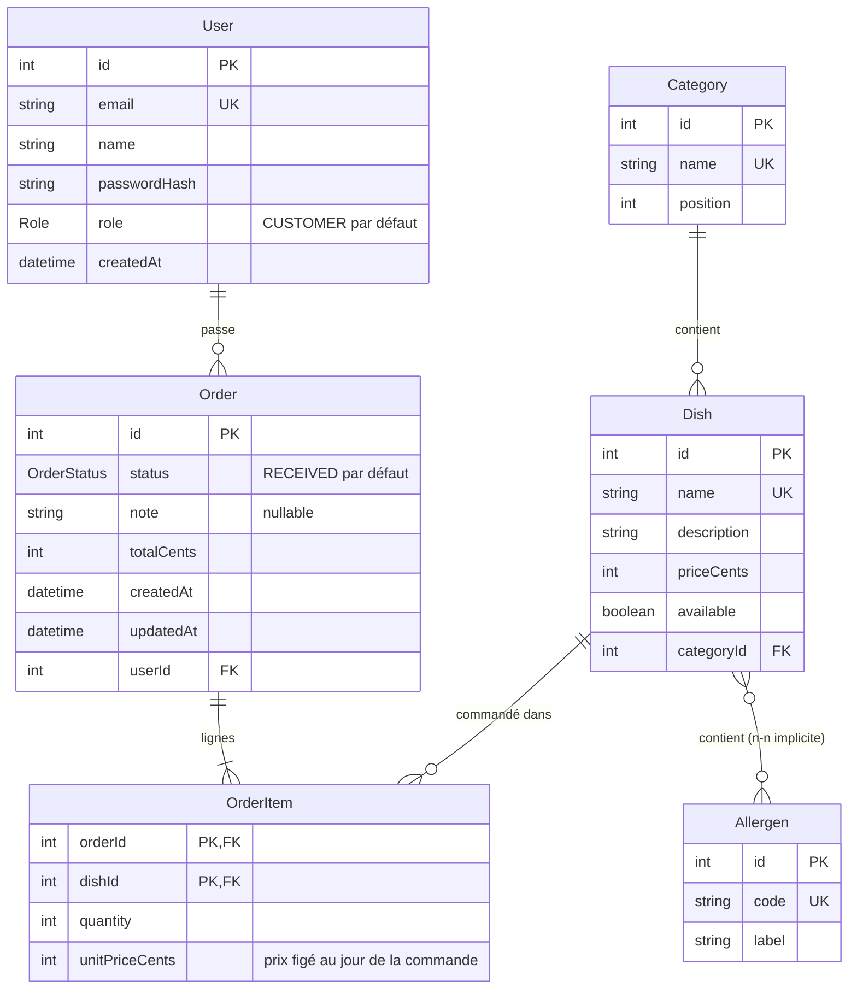

# La Roulotte — API

API de click & collect du food truck La Roulotte : carte, comptes, commandes.
Stack : Node.js 22+, TypeScript strict, Express 5, Prisma 7 (SQLite), Zod, Vitest, Supertest.

## Palier atteint : 1 — Service minimum ✅

| Critère du palier 1 | État |
|---|---|
| `npm run recette:1` | **37 / 37 tests verts** |
| Nos tests (`npm test`) | **22 tests verts** (6 exigés), dont des tests unitaires de services |
| Parcours dans le front | connexion, carte, panier, commande, suivi dans « Mes commandes » |
| Tag | `palier-1` |

## Lancement en 5 commandes

Prérequis : **Node.js 22 ou plus** (`node -v`), et le kit du projet (`la-roulotte-kit`) dans un dossier à part.

```powershell
npm ci                          # dépendances exactes + génération du client Prisma (postinstall)
Copy-Item .env.example .env     # (bash : cp .env.example .env) puis remplacer JWT_SECRET
npx prisma migrate deploy       # crée dev.db et applique les migrations
npm run seed                    # charge la carte et les 3 comptes de démonstration
npm run dev                     # http://localhost:3000
```

Vérification : `curl.exe http://localhost:3000/health` répond `{"status":"ok"}`.

### Le fichier `.env`

Le `.env` n'est jamais commité : chacun a le sien, créé à partir de `.env.example`.
`JWT_SECRET` doit faire 16 caractères au moins, sinon l'API refuse de démarrer. Pour en générer un :

```powershell
node -e "console.log(require('crypto').randomBytes(32).toString('hex'))"
```

| Variable | Rôle | Valeur par défaut |
|---|---|---|
| `PORT` | Port HTTP de l'API | `3000` |
| `DATABASE_URL` | Fichier SQLite | `file:./dev.db` |
| `JWT_SECRET` | Secret de signature des jetons | à générer |
| `JWT_EXPIRES_IN` | Durée de validité des jetons | `2h` |
| `CORS_ORIGIN` | Origine autorisée (le front) | `http://localhost:5173` |

La configuration est validée au démarrage par Zod ([src/config.ts](src/config.ts)) : une variable absente ou invalide arrête l'API avec un message explicite.

## Scripts

| Commande | Effet |
|---|---|
| `npm run dev` | Lance l'API et la relance à chaque modification |
| `npm start` | Lance l'API sans rechargement |
| `npm run seed` | Vide la base et recharge `donnees/menu.json` |
| `npm test` | Lance nos tests (Vitest + Supertest), sans base ni API lancée |
| `npm run typecheck` | Vérifie les types TypeScript |

## Travailler avec le kit

Dans un **second terminal**, depuis le dossier `la-roulotte-kit` (l'API doit tourner) :

```powershell
npm run front          # le front sur http://localhost:5173
npm run recette:1      # recette du palier 1 (recette:2, :3, :4 pour les suivants)
```

La recette crée des comptes, des plats et des commandes : relancer `npm run seed` pour repartir d'une base propre.

| Email | Mot de passe | Rôle |
|---|---|---|
| admin@roulotte.test | Admin123! | ADMIN |
| cuisine@roulotte.test | Cuisine123! | STAFF |
| client@roulotte.test | Client123! | CUSTOMER |

## Routes du palier 1

| Requête | Accès | Effet |
|---|---|---|
| `GET /health` | public | `{ "status": "ok" }` |
| `GET /categories` | public | Catégories triées par position |
| `GET /allergens` | public | Les 14 allergènes, triés par code |
| `GET /dishes` | public | Carte paginée ; filtres `category`, `available`, `allergenFree`, `q` |
| `GET /dishes/:id` | public | Un plat |
| `POST /auth/register`, `POST /auth/login`, `GET /auth/me` | module fourni | Inscription (toujours CUSTOMER), connexion, compte connecté |
| `POST /orders` | connecté | Passer une commande (201 + `Location`) |
| `GET /orders` | connecté | Ses commandes ; toutes pour STAFF et ADMIN ; filtres `status`, `sort` |
| `GET /orders/:id` | connecté | Sa commande ; toutes pour STAFF et ADMIN ; **404** pour celle d'un autre client |

## Ce qui ne marche pas (encore)

- **`PATCH /orders/:id/status`** (avancer ou annuler une commande) relève du palier 2 : le bouton « Annuler » du front répond pour l'instant 404.
- **Recherche `q`** : insensible à la casse pour les lettres sans accent seulement (limite de `LIKE` sous SQLite) ; « é » et « É » ne sont pas confondus.
- **Tri des plats par nom** : SQLite compare octet par octet. Les plats du seed sont bien triés, mais un plat créé avec une minuscule ou un accent en tête de nom pourrait être mal placé.

## Schéma de données



Les trois formes de relation demandées sont présentes :
- **1-n** : `User` → `Order`, `Category` → `Dish` ;
- **n-n implicite** : `Dish` ↔ `Allergen` (table de jointure gérée par Prisma) ;
- **n-n explicite** : `Order` ↔ `Dish` via `OrderItem`, avec une clé composite `(orderId, dishId)` et des données propres (quantité, prix figé).

`OrderItem → Dish` est en `onDelete: Restrict` : un plat déjà commandé ne peut pas être supprimé. `OrderItem → Order` est en `onDelete: Cascade`.

## Architecture

```
src/
├── server.ts            point d'entrée : crée les repositories Prisma, le container, lance l'app
├── app.ts               createApp(container) : middlewares et routes, dans l'ordre imposé
├── container.ts         composition root : assemble repositories → services → controllers
├── config.ts            configuration .env validée par Zod
├── db/prisma.ts         le PrismaClient unique
├── shared/              écrit une seule fois : erreurs, gestionnaire d'erreurs, validation, pagination
├── fourni/auth/         module d'authentification fourni (non modifié)
└── modules/
    ├── users/           UserRepository (branché sur le module d'auth)
    ├── menu/            carte : catégories, allergènes, plats
    └── orders/          commandes
tests/
├── fakes/               repositories en mémoire (même interface que Prisma)
├── helpers/test-app.ts  construit l'app sans base, crée des comptes de test
└── *.test.ts            tests unitaires (services) et HTTP (Supertest)
```

Chaque module suit le même découpage :

| Couche | Fichier | Rôle |
|---|---|---|
| Routes | `*.routes.ts` | Chemins et protections (`requireAuth`, `requireRole`) |
| Controller | `*.controller.ts` | Valide l'entrée (Zod), appelle le service, renvoie le DTO. Seule couche qui voit `req`/`res` |
| Service | `*.service.ts` | Règles métier (prix, refus, propriété des commandes). Ni HTTP ni Prisma |
| Repository | `*.repository.ts` | Interface et types du domaine |
| Implémentation | `prisma-*.repository.ts` | Seul endroit qui importe Prisma |
| Entrée / sortie | `*.schemas.ts`, `*.dto.ts` | Schémas Zod stricts ; fonctions `toXxxDto` |

Ordre des middlewares ([src/app.ts](src/app.ts)) : `installSecurity` (Helmet, CORS, JSON limité à 100 ko) → routes → 404 → `authErrorHandler` → notre gestionnaire d'erreurs unique.

### Choix et patterns, justifiés par le projet

| Pattern / principe | Problème du projet | Où |
|---|---|---|
| **Composition root** + **inversion des dépendances** | Les services ne doivent connaître ni Prisma ni la base, pour être testés sans elle | [src/container.ts](src/container.ts) |
| **Factory** | Construire la même application avec des repositories Prisma (en production) ou en mémoire (dans les tests) | `createApp` ([src/app.ts](src/app.ts)), `createContainer` ([src/container.ts](src/container.ts)) |
| **Singleton** | Un seul pool de connexions à la base pour toute l'application | [src/db/prisma.ts](src/db/prisma.ts) |
| **DAO / Repository** | Isoler tout accès aux données derrière une interface par agrégat | `menu.repository.ts`, `order.repository.ts`, `user.repository.ts` et leurs versions `prisma-*` |
| **Adapter** | Le module d'auth fourni attend un `AuthUserStore` : notre `UserRepository` respecte cette interface | [src/modules/users/user.repository.ts](src/modules/users/user.repository.ts) |
| **DTO** | Ne jamais exposer `passwordHash` ni de champ hors contrat ; refuser `role`, `unitPriceCents`… en entrée | `*.schemas.ts` (`strictObject`), `*.dto.ts` |
| **ISP** | Le service des commandes n'a besoin que de lire les prix des plats | `Pick<MenuRepository, "findDishesByIds">` dans [order.service.ts](src/modules/orders/order.service.ts) |
| **DRY** | Format d'erreur, validation, pagination et sélections Prisma écrits une seule fois | [src/shared/](src/shared/), `dishSelect`, `orderInclude` |

### Contrôle d'accès

- La carte est publique. Le routeur `/orders` est entièrement protégé par `requireAuth`.
- La **propriété** d'une commande est vérifiée dans le service : un client ne voit que les siennes. La commande d'un autre client répond **404 et non 403**, pour ne pas révéler qu'elle existe.
- Les **prix viennent toujours de la base** : le client n'envoie que `dishId` et `quantity` ; `unitPriceCents` fige le prix du jour.
- L'inscription donne toujours le rôle CUSTOMER : un champ `role` envoyé est refusé (400).

## Tests

```powershell
npm test
```

Ils tournent **sans base ni API lancée** : `buildTestApp()` construit l'application avec des repositories en mémoire ([tests/fakes/](tests/fakes/)), qui respectent les mêmes interfaces que les versions Prisma.

| Fichier | Type | Ce qui est vérifié |
|---|---|---|
| `app.test.ts` | HTTP | `/health`, 404 au format du contrat, inscription → connexion → `/auth/me`, 401, rôle refusé |
| `menu.service.test.ts` | unitaire | 404 sur plat inexistant, format de page |
| `menu.http.test.ts` | HTTP | tri, pagination, filtres, 400 et 404 |
| `order-place.test.ts` | unitaire + HTTP | prix lus en base, refus cumulés (422) sans écriture, 401, 201 + `Location`, 400 |
| `order-access.test.ts` | HTTP | un client ne voit que ses commandes, 404 pour celle d'un autre, la cuisine voit tout |

La recette du kit complète ces tests en vérifiant le contrat sur l'API réelle, avec la vraie base.

## Répartition du travail

| Membre | Contributions |
|---|---|
| **Matthieu** | Initialisation du projet (Express, Prisma 7, configuration), socle commun (erreurs, validation, pagination, composition root), branchement du module d'auth, module `menu`, `POST /orders`, alignement du module `orders` sur le contrat et la structure, README |
| **Goodman** | Module `orders` : `GET /orders` et `GET /orders/:id`, filtrage client / cuisine, masquage par 404, tests de contrôle d'accès |

<!-- À compléter et à corriger ensemble avant le rendu : noms complets, et toute contribution manquante. -->

## Au quotidien

Après un `git pull` qui touche aux dépendances ou au schéma Prisma :

```powershell
npm ci                       # régénère aussi le client Prisma
npx prisma migrate deploy
```

Pour **modifier le schéma** (`prisma/schema.prisma`), une migration par évolution :

```powershell
npx prisma migrate dev --name <nom-explicite>   # ex. : stock, image-url, payment-status
npx prisma generate                             # Prisma 7 ne le fait plus automatiquement
```

On commite le dossier `prisma/migrations/` créé : l'historique des migrations fait partie du rendu.
Ne jamais modifier une migration déjà poussée, en créer une nouvelle.

Pour repartir de zéro (supprime toutes les données) : `npx prisma migrate reset` puis `npm run seed`.

### Branches

```
main ── dev ──┬── dev-matthieu
              └── dev-goodman
```

- On travaille sur sa branche, on fusionne dans `dev` quand une partie est verte (`npm test` et `npm run typecheck`).
- Avant de fusionner dans `dev`, on récupère `dev` sur sa branche (`git merge dev`) et on règle les conflits chez soi : la fusion dans `dev` reste une simple avance rapide.
- `dev` passe sur `main` uniquement quand un palier est terminé (recette verte), avec un tag `palier-N`.

## Problèmes fréquents

| Symptôme | Cause et solution |
|---|---|
| `Cannot find module '../generated/prisma/client.js'` | Le client Prisma n'est pas généré : `npx prisma generate` (ou `npm ci`) |
| `/health` répond autre chose que `{"status":"ok"}`, ou `EADDRINUSE` au démarrage | Une autre application occupe le port 3000. La trouver : `Get-NetTCPConnection -LocalPort 3000 -State Listen`, l'arrêter, ou changer `PORT` dans `.env` |
| L'API refuse de démarrer : « Configuration invalide » | Une variable manque ou est invalide dans `.env` (souvent `JWT_SECRET` trop court) |
| Le front affiche « API injoignable » | L'API ne tourne pas, ou `CORS_ORIGIN` ne vaut pas `http://localhost:5173` |
| `prisma` en version 8 après une installation | Toujours installer avec `npm ci` : le projet est figé sur **Prisma 7.10.1**. Ne pas lancer `npm install prisma` sans version |
| Le seed échoue sur une contrainte unique | La base contient déjà des données de la recette : `npx prisma migrate reset` puis `npm run seed` |

## Règles du projet

- Les fichiers fournis par le kit ne se modifient pas : `src/fourni/auth/` et `donnees/menu.json`.
- Ne jamais commiter : `.env`, `*.db`, `node_modules/`, `src/generated/`, `uploads/` (déjà dans le `.gitignore`).
- Pas de `req`/`res` dans un service, pas de Prisma hors des repositories.
- Messages de commit au format Conventional Commits : `feat(orders): …`, `fix(menu): …`, `test: …`, `docs: …`.
